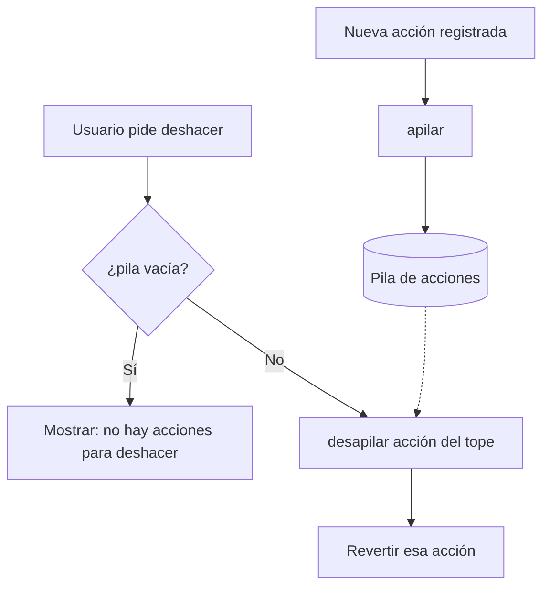

# Actividad 1. Pila LIFO

## 1. ¿Qué caracteriza a una estructura LIFO?

LIFO significa *Last In, First Out*: **el último elemento en entrar es el primero en salir**. Una pila (*stack*) es una estructura lineal de acceso restringido con estas características:

- Solo se inserta por un extremo, llamado **tope** (cima).
- Solo se elimina por ese mismo extremo.
- Solo se puede consultar directamente el elemento del tope; los demás quedan "tapados" hasta que se retiran los de arriba.
- Las operaciones principales (apilar, desapilar, ver tope, verificar vacía) tienen complejidad **O(1)**.

Analogía: una pila de platos. El último plato que se coloca es el primero que se retira.

## 2. Caso propuesto

La unidad de servicios académicos necesita **deshacer acciones en orden inverso al que fueron registradas** (por ejemplo: modificar una nota, cambiar un horario, corregir un dato de matrícula). Cada acción registrada se guarda en una pila; al deshacer, siempre se revierte la **más reciente**.

## 3. Representación gráfica

Se registran, en este orden, tres acciones: `A1`, `A2`, `A3`.

```
Estado inicial      apilar(A1)       apilar(A2)       apilar(A3)
(vacía)
                                                      |  A3  | <- tope
                                     |  A2  | <- tope |  A2  |
                    |  A1  | <- tope |  A1  |         |  A1  |
  +------+          +------+         +------+         +------+
  tope = -1         tope = 0         tope = 1         tope = 2
```

Al deshacer, el orden de salida es **A3 → A2 → A1** (inverso al de registro):

```
desapilar() -> A3      desapilar() -> A2      desapilar() -> A1
|  A2  | <- tope       |  A1  | <- tope       (vacía)
|  A1  |
+------+              +------+               +------+
tope = 1              tope = 0               tope = -1
```

Diagrama de flujo de las operaciones:



## 4. Algoritmos (pseudocódigo)

Se usa una implementación con **vector** de capacidad `MAX`, donde `tope = -1` indica pila vacía.

### Estructura

```
Estructura Pila
    datos[MAX]      // arreglo de acciones
    tope ← -1       // índice del último elemento
Fin Estructura
```

### Verificar si la pila está vacía

```
Función estaVacia(P) : Booleano
    Retornar (P.tope = -1)
Fin Función
```

### Verificar si la pila está llena (necesaria al usar vector)

```
Función estaLlena(P) : Booleano
    Retornar (P.tope = MAX - 1)
Fin Función
```

### Apilar (push)

```
Procedimiento apilar(P, elemento)
    Si estaLlena(P) entonces
        Mostrar "Error: desbordamiento (overflow)"
    Sino
        P.tope ← P.tope + 1
        P.datos[P.tope] ← elemento
    Fin Si
Fin Procedimiento
```

### Desapilar (pop)

```
Función desapilar(P) : Elemento
    Si estaVacia(P) entonces
        Mostrar "Error: pila vacía (underflow)"
        Retornar NULO
    Sino
        elemento ← P.datos[P.tope]
        P.tope ← P.tope - 1
        Retornar elemento
    Fin Si
Fin Función
```

### Visualizar el elemento del tope (peek)

```
Función verTope(P) : Elemento
    Si estaVacia(P) entonces
        Mostrar "La pila está vacía"
        Retornar NULO
    Sino
        Retornar P.datos[P.tope]     // no lo elimina
    Fin Si
Fin Función
```

### Prueba de escritorio

| Operación | tope | Contenido (base → tope) | Resultado |
|---|---|---|---|
| inicio | -1 | [ ] | estaVacia = Verdadero |
| apilar("Cambiar nota") | 0 | [Cambiar nota] | |
| apilar("Cambiar horario") | 1 | [Cambiar nota, Cambiar horario] | |
| verTope() | 1 | sin cambios | "Cambiar horario" |
| desapilar() | 0 | [Cambiar nota] | "Cambiar horario" |
| desapilar() | -1 | [ ] | "Cambiar nota" |
| desapilar() | -1 | [ ] | Error: pila vacía |

### Complejidad

| Operación | Tiempo |
|---|---|
| apilar | O(1) |
| desapilar | O(1) |
| verTope | O(1) |
| estaVacia | O(1) |

## 5. Aplicación concreta en el caso

**Historial de acciones para deshacer (Undo) en el sistema de la unidad de servicios académicas.**

Cada vez que un personal administrativo modifica un registro (nota, horario, dato de matrícula), la acción se apila. Si se equivoca, el botón "Deshacer" ejecuta `desapilar()` y revierte **la última acción realizada**, luego la anterior, y así sucesivamente.

**¿Por qué la pila es la más adecuada?** Porque deshacer exige revertir en **orden inverso** al registro. Si se revirtiera primero la acción más antigua, el estado del sistema quedaría inconsistente (por ejemplo, deshacer un cambio de horario antes de deshacer la modificación que dependía de él). El comportamiento LIFO garantiza el orden correcto con acceso O(1) y sin recorrer la estructura.

Otras aplicaciones de las pilas vistas en clase: botón "atrás" del navegador y evaluación de expresiones matemáticas.

## Fuentes

- Sesión 09: *Estructuras LIFO (Pilas)*, curso 30710 Algoritmo y Estructura de Datos basados en IA.
- Cormen, T., Leiserson, C., Rivest, R., & Stein, C. (2022). *Introduction to Algorithms*. MIT Press.
- Goodrich, M., Tamassia, R., & Goldwasser, M. (2020). *Data Structures and Algorithms in Java*. Wiley.
